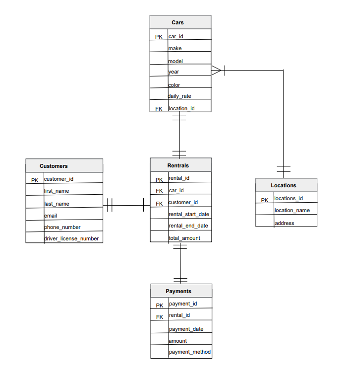

# Project 2: Rental Car System

## 📌 Overview
This project focuses on database design and PL/SQL implementation for a car rental company with multiple locations. The system centralizes vehicle availability management, customer information, rental transactions, and payment records.

## 🏗 Database Design & Architecture
- **ER Diagram**: Designed a relational model consisting of 5 entities: `Cars`, `Customers`, `Rentals`, `Payments`, and `Locations`.
- **Relationships**: Clearly defined Many-to-One and One-to-One relationships to maintain referential integrity.

## 💻 PL/SQL Implementation (Procedures & Functions)
Implemented stored procedures and functions with robust error handling and validation. (Please refer to the `/images` folder for execution results).

### 1. Stored Procedures
- **Calculate Customer Total Spends**: Calculates the total payment amount for a specific customer ID. Includes exception handling for non-existent IDs.
- **Calculate Rental Amount**: Calculates the rental fee based on the car ID, start date, and end date. Implements strict date validation (e.g., handling NULL values and ensuring the end date is later than the start date).

### 2. Stored Functions
- **Get the Car's Revenue by Their Make**: Returns the total revenue generated by a specific car manufacturer.
- **Get the Customer's Payment**: Returns the total payment amount for a specific customer ID.

## 📂 Project Artifacts
- `/images`: Contains the ER Diagram and PL/SQL execution results demonstrating the scenarios (success cases and error handling).

## 📊 ER Diagram

## 💻 PL/SQL Execution Results

### Procedure 1: Calculate Customer Total Spends
- [Scenario 1: User Enter Correct Customer ID](images/proc1_scen1.png)
- [Scenario 2: User Enter Incorrect Customer ID](images/proc1_scen2.png)

### Procedure 2: Calculate Rental Amount
- [Scenario 1: User Enter Correct Car ID](images/proc2_scen1.png)
- [Scenario 2: User Enter Incorrect Date (End date before start date)](images/proc2_scen2.png)
- [Scenario 3: User Not Enter Input In The Date](images/proc2_scen3.png)
- [Scenario 4: User Enter Incorrect Car ID](images/proc2_scen4.png)

### Function 1: Get the Car's Revenue by Their Make
- [Execution Result](images/func_1.png)
- [Scenario 1: Calculate The Revenue for Proton](images/func1_scen1.png)
- [Scenario 2: Calculate The Revenue for Mitsubishi](images/func1_scen2.png)

### Function 2: Get the Customer's Payment
- [Execution Result](images/func2.png)
- [Scenario 1: Get the payment for Customer with Customer_ID 2242](images/func2_scen1.png)
- [Scenario 2: Get the payment for Customer with Customer_ID 2241](images/func2_scen2.png)
